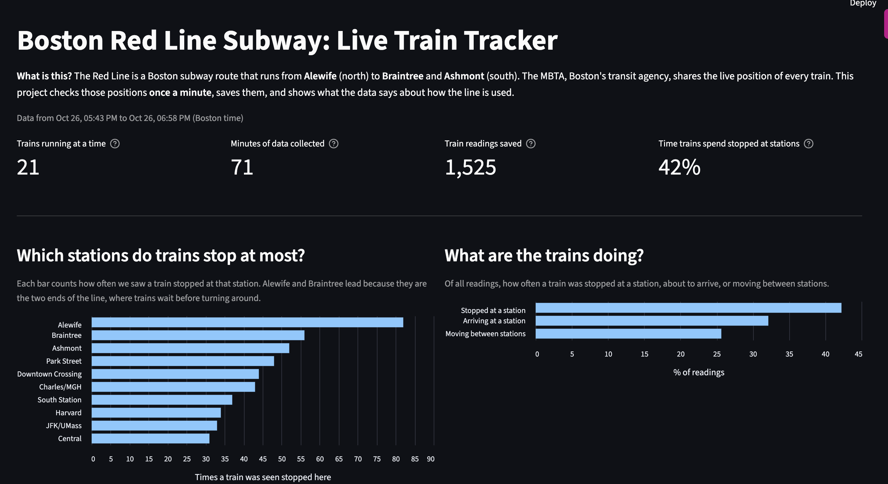

# Boston Red Line Live Train Tracker

A data pipeline and dashboard that tracks Boston's Red Line subway in near real time.

## What is this?
The MBTA (Boston's transit agency) shares the live position of every train through a free public API.
This project checks those positions **every 60 seconds**, saves them in a database, and uses SQL to answer questions about how the line is used.

## What it answers
- Which stations do trains stop at most?
- What share of the time are trains stopped, arriving, or moving?
- How many trains are running at different times of day?
- How long do trains wait at each station (dwell time)?

## Early findings
Based on about 70 minutes of evening data (more is being collected):
- About **42%** of train readings show a train stopped at a station.
- **Alewife** and **Braintree** (the two ends of the line) show the most stopped trains, because trains wait there before turning around.
- Around **21 to 22 trains** were running at the same time.

## How it works
| Step | File | What it does |
|---|---|---|
| 1 | `create_db.py` | Creates the SQLite database and tables |
| 2 | `load_stops.py` | Loads station names, so codes become names like "Harvard" |
| 3 | `collect.py` | Fetches live train positions and saves one row per train |
| 4 | `run_collector.py` | Runs the collector every 60 seconds |
| 5 | `questions.py` | SQL analysis: counts, percentages, JOINs, dwell time |
| 6 | `dashboard.py` | Streamlit dashboard that shows the results |

## Tech used
Python, SQL (SQLite), Pandas, Streamlit, Altair, MBTA V3 API

## Run it yourself
    pip install requests pandas streamlit altair
    python create_db.py
    python load_stops.py
    python run_collector.py      # leave running, stop with Ctrl+C
    streamlit run dashboard.py   # in a second terminal

## Limits
- Positions are sampled once a minute, so dwell times are estimates (about plus or minus 60 seconds).
- Only a short window of data so far. Daily patterns need more collection time.

## Next steps
- Run the collector in the cloud so it collects 24/7.
- Add rush-hour vs off-peak comparison once there is a full day of data.